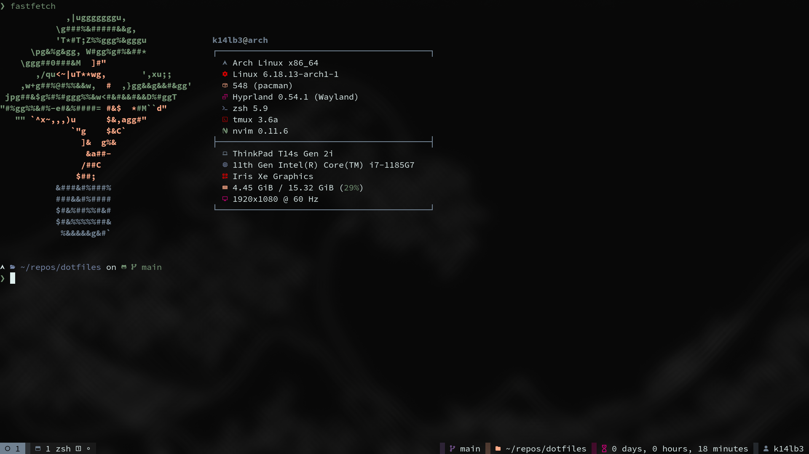
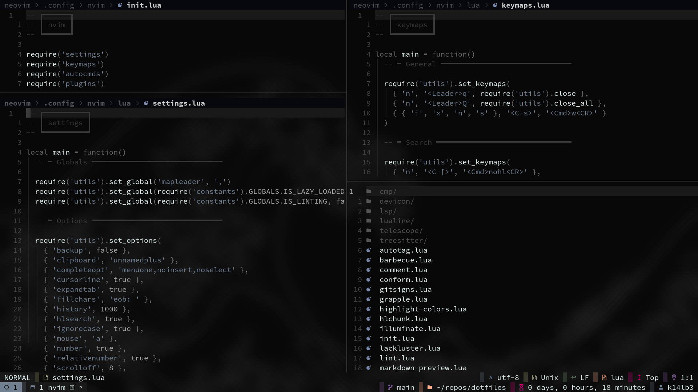

# dotfiles

Personal dotfiles — the dotfiles that are personal.


## Install

> [!WARNING]
> Use at your own risk. I'm not responsible if your computer explodes.
>
> 

```sh
bash -c "$(curl -fsSL https://raw.githubusercontent.com/supagetto/dotfiles/main/install)"
```

## Screens




